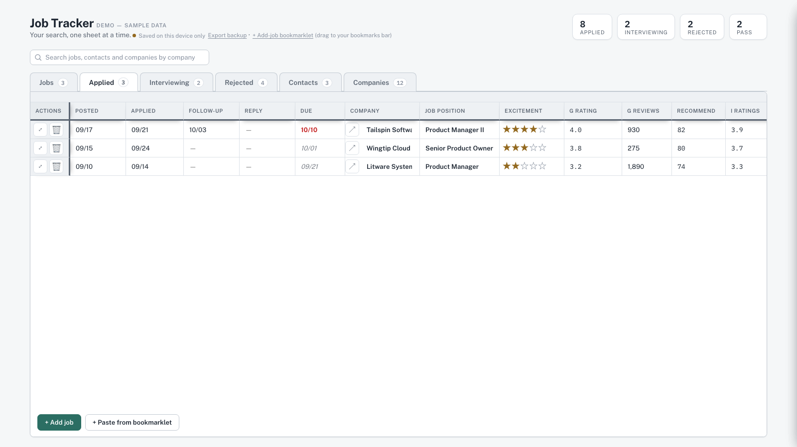
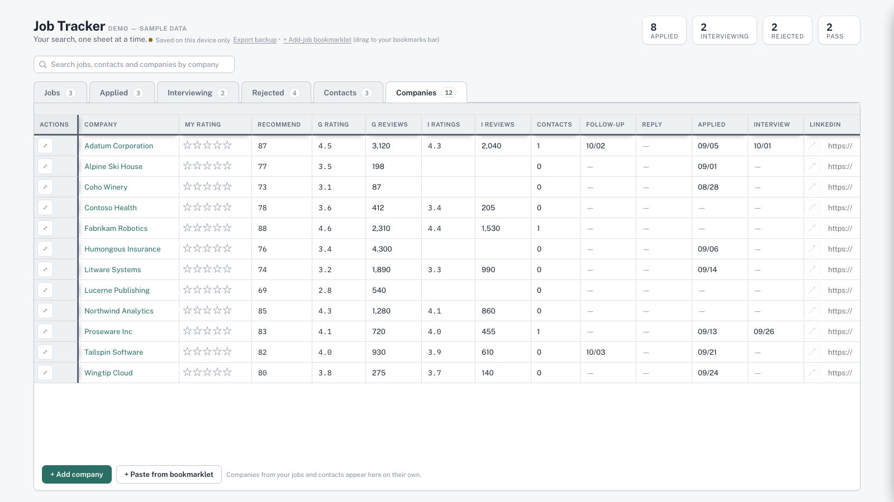
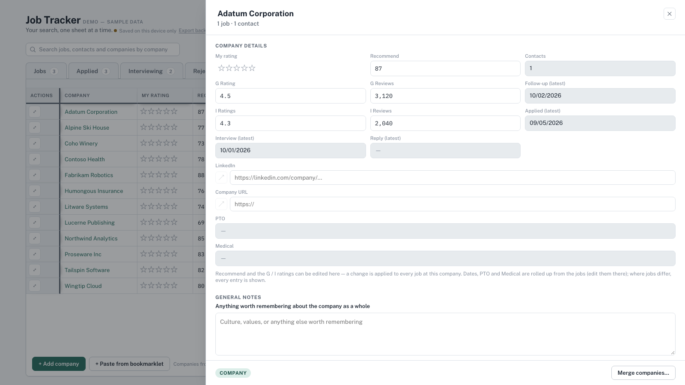
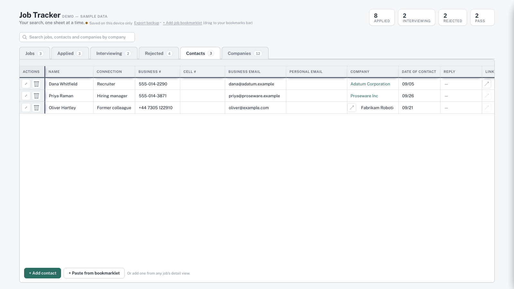

# Job Tracker

A spreadsheet-style job-search tracker that runs as a single HTML file. Track jobs through
**Jobs → Applied → Interviewing → Rejected**, keep **Contacts**, and see everything rolled up
by **Company**. It was built iteratively with [Claude Code](https://claude.com/claude-code) as a
working prototype for a real job search.

## Try it

Open [`demo/job-tracker-demo.html`](demo/job-tracker-demo.html) in a browser. It starts with
fictional sample data (fake companies and people), and everything you change is stored in your
browser's local storage. No install, no server, no account.

## What it does

- **Six tabs.** Jobs, Applied, Interviewing, Rejected, Contacts, Companies. Inline editing in
  the table, sortable and resizable columns, a pinned header and Actions column, dark mode.
- **Slide-out records.** Open any job, contact or company in a drawer for the full detail.
- **Stages move themselves.** Filling in *Date applied*, *Date rejected* or ticking
  *Interviewing* moves the job to the right tab.
- **Follow-up due, automatically.** *Due* is set to 7 days after the latest applied date,
  follow-up or interview, and recolors as it goes overdue (orange, then red and bold, then grey
  with a "consider closing" hint).
- **Logs that behave like dates.** Follow-ups, Interviews and Replies are lists of dated notes.
  Their table columns show only the most recent date, as MM/DD, with a dash when empty so gaps
  are easy to spot.
- **Ratings in one place.** Two sets of review-site ratings and review counts (G and I), a
  Recommend %, and star ratings for Excitement (per job) and My rating (per company).
- **Contacts.** Business and cell numbers (international formats like `+44 7700 900123`),
  business and personal email, LinkedIn, and dated replies.
- **Companies, without extra data entry.** A company is every distinct name found on a job or
  contact, rolled up into one row: latest follow-up, application, interview and reply, contact
  count, and PTO and medical notes from every job (differing entries are all kept, never
  overwritten). You can add, rename, delete and **merge** companies, and editing a rating on a
  company updates every job there, with an overwrite-or-cancel prompt if the jobs disagree.
- **Capture from a job page.** A bookmarklet copies a posting's title, company and link; paste
  it into the tracker to create a job (or a company, from the Companies tab).
- **Backups.** Export everything to a JSON file.

| Companies | Company slide-out | Contacts |
|---|---|---|
|  |  |  |

## Running your own copy with cloud sync

[`src/job-tracker.html`](src/job-tracker.html) is the same app without sample data. Opened as a plain
file it stores data in the browser only.

I run it as a [Claude Artifact](https://claude.com), where it uses the artifact's `db` capability
for live cloud sync across devices (and `downloads` for the backup export). Publish the file as an
artifact with those two capabilities and it syncs automatically; if the capability isn't available
it falls back to local storage.

The bookmarklet opens the tracker at one address, set by `TRACKER_URL` near the top of the
bookmarklet section. Replace the placeholder with the link to your own published copy.

## Status and limits

This is a working prototype of a personal tool, not a product.

- One HTML file of roughly 5,000 lines, with no build step. Easy to run, harder to navigate.
- No automated test suite. Behaviour was verified by driving the app in a browser during
  development.
- Cloud sync depends on the Claude Artifacts `db` capability. Elsewhere it is local-only.
- Companies are matched by name. A typo creates a separate company until you merge them.
  Merging changes the Company field on the affected jobs and contacts and can't be undone.

See [`docs/ARCHITECTURE.md`](docs/ARCHITECTURE.md) for how it works and [`CHANGELOG.md`](CHANGELOG.md)
for what has been built.

## Privacy

The code and demo contain only fictional data. Your own data stays in your browser (or in your own
artifact's database). `.gitignore` excludes the backup files the app exports so they aren't
committed by accident.

## History

The commit history is a reconstruction. The tracker was built in one long conversation with Claude
Code and published to a live copy after each change. This repo has one commit per published version
(about 90), dated when that version went live. The code in each commit was rebuilt by replaying the
logged edits, and the result was checked against the published versions at several points; the final
version is identical to the live one. The commit messages are short summaries written afterwards.
Experiments and test files that were never published are not included.

## License

No license has been chosen yet, so by default all rights are reserved.
